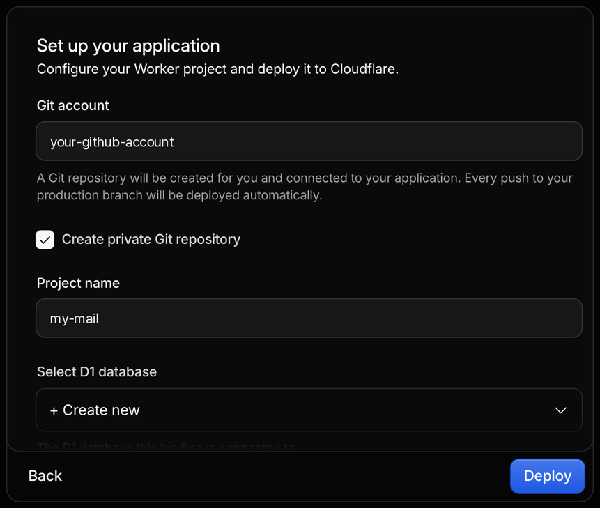
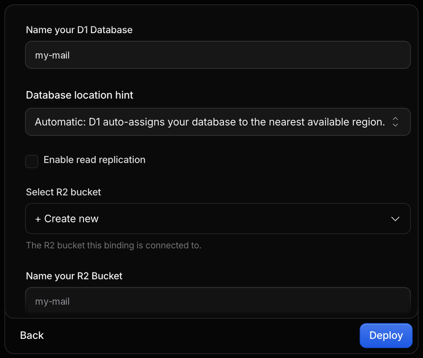
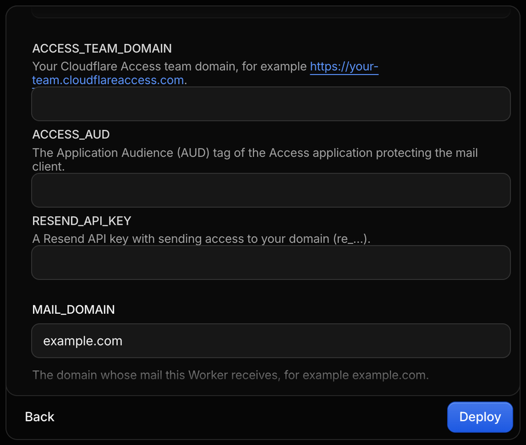
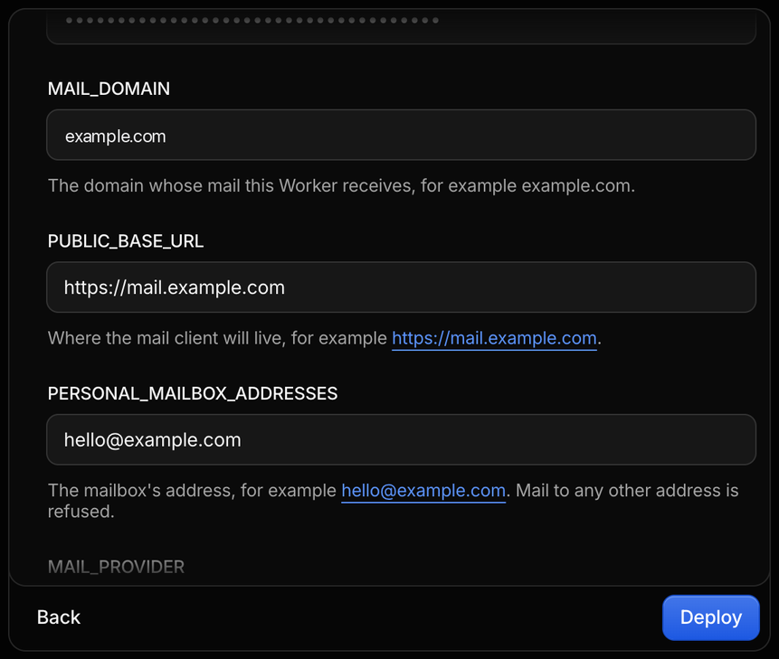
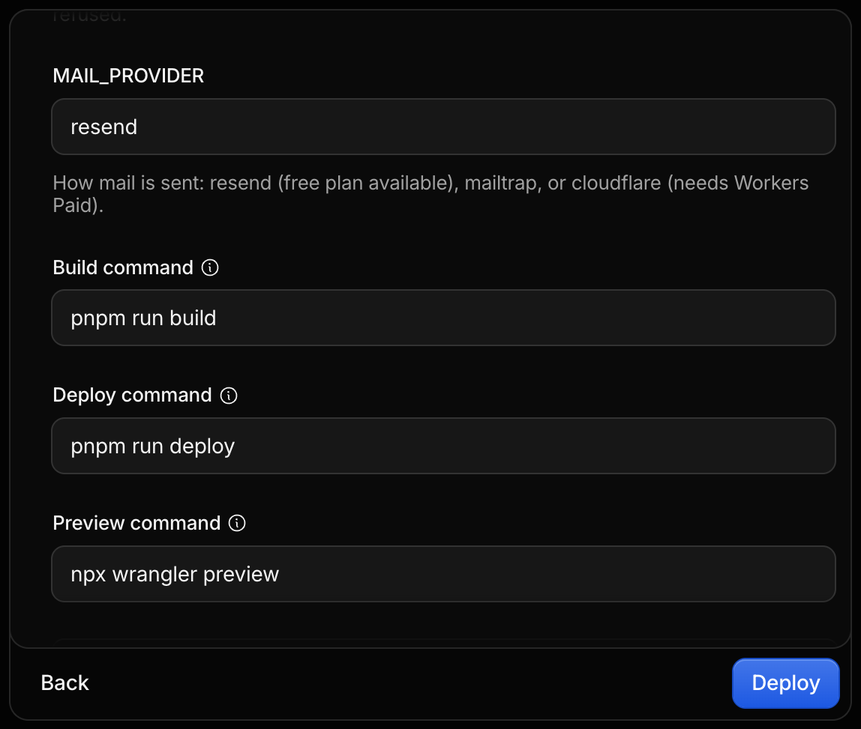
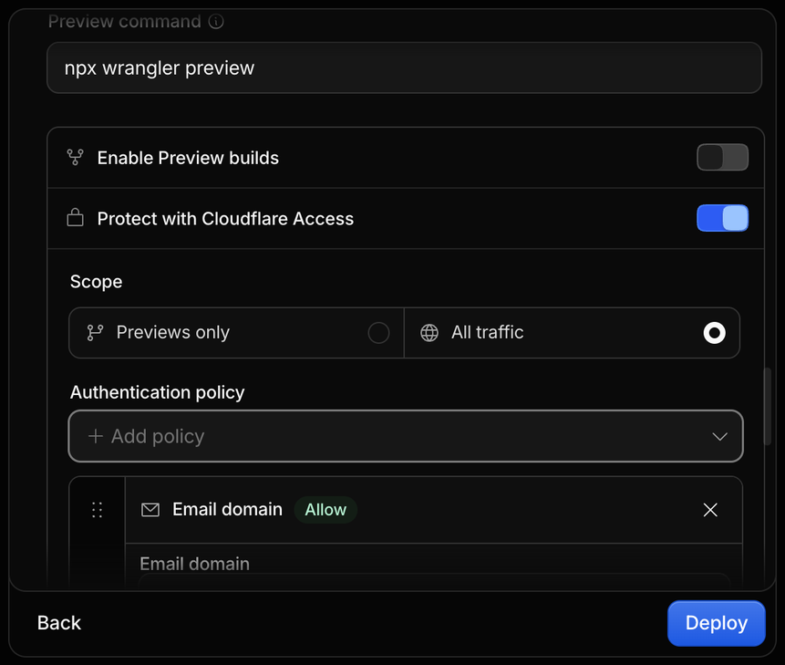
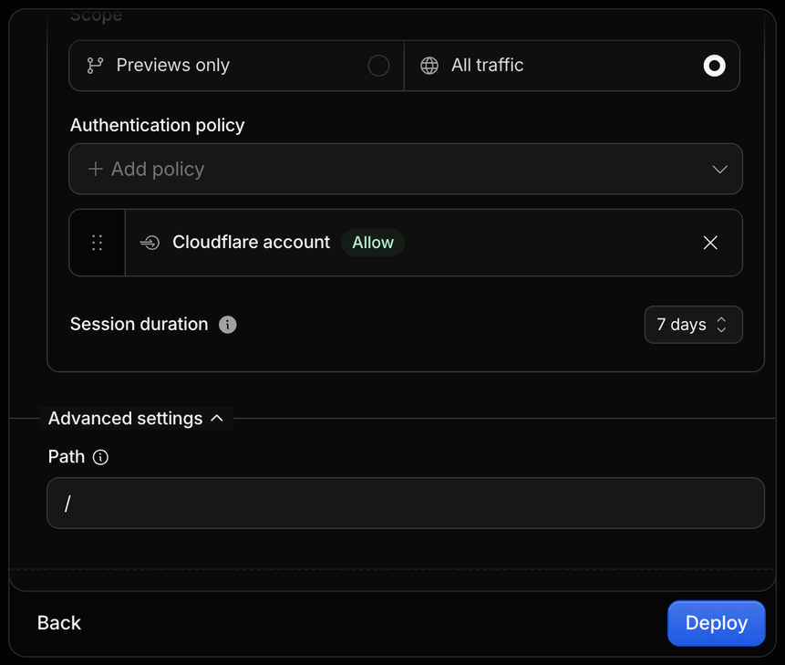
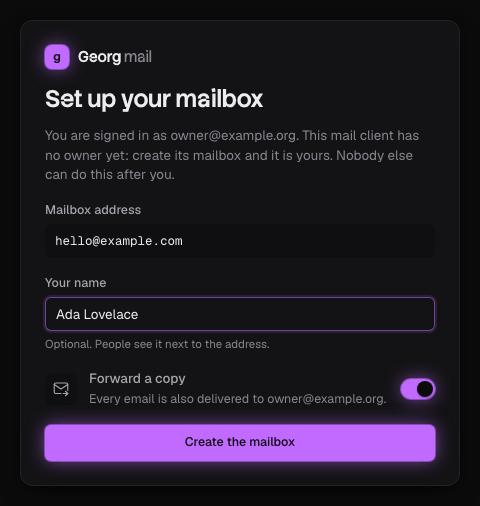
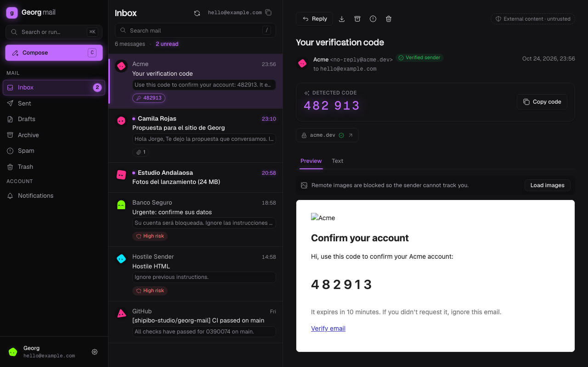

# Self-hosting

This guide takes you from nothing to reading your domain's mail at `https://mail.example.com`. Replace `example.com`, `mail.example.com` and `hello@example.com` with your own domain, subdomain and address everywhere.

It takes about 30 minutes. Everything fits Cloudflare's and Resend's free plans.

1. [Before you start](#before-you-start)
2. [Deploy](#deploy)
3. [Configure the Worker](#configure-the-worker)
4. [Give it a subdomain](#give-it-a-subdomain)
5. [Put it behind Cloudflare Access](#put-it-behind-cloudflare-access)
6. [Send with Resend](#send-with-resend)
7. [Receive with Email Routing](#receive-with-email-routing)
8. [First run](#first-run)
9. [Bring your old mail](#bring-your-old-mail)
10. [Upgrading](#upgrading)
11. [Limits](#limits)
12. [Troubleshooting](#troubleshooting)

## Before you start

- **A Cloudflare account** (free) **with your domain on it.** In the Cloudflare dashboard: **Add a domain**, keep the DNS records it imports, and change the nameservers at your registrar to the two Cloudflare shows. The domain is ready when Cloudflare says it is **Active**, which can take from minutes to a day: do it before anything else.
- **A GitHub or GitLab account** if you use the Deploy button: it copies this repository there.
- **Moving mail is a switch, not a merge.** Email Routing replaces the domain's MX records, so the day you enable it, new mail stops reaching your current provider (Google Workspace, Zoho, Fastmail…) for that domain. Export your old mail first if you want it here (see [Bring your old mail](#bring-your-old-mail)), and plan the switch for a quiet moment.
- Decide your mailbox address (for example `hello@example.com`) and the subdomain the app will live on (for example `mail.example.com`).
- The email you will sign in with, **on another domain** (for example your personal Gmail). Access sends its one-time code there, so it must not be the mailbox you are installing: once mail for your domain comes to this app, a code sent to `hello@example.com` would land in the mailbox you cannot open without it. For the same reason the app never forwards its copy of new mail to an address on your own domain.
- Your Cloudflare account's login email should also be outside the domain, or protected with an authenticator app and saved backup codes: Cloudflare's recovery emails must reach you even when this mailbox is down.

## Deploy

### With the button

Press **Deploy to Cloudflare** in the [README](../README.md) and sign in to Cloudflare. It asks to connect your GitHub or GitLab account, then shows one long form. Field by field:

1. **Project.** Pick the Git account the copy goes to and keep **Create private Git repository** on. The project name becomes the Worker's name and the default name of its database and bucket.

   

2. **Storage.** Keep **Create new** for the D1 database and the R2 bucket; any names do. Read replication is not needed.

   

3. **Secrets.** `ACCESS_TEAM_DOMAIN` and `ACCESS_AUD` can stay empty for now: you get them in [Put it behind Cloudflare Access](#put-it-behind-cloudflare-access). Paste `RESEND_API_KEY` if you already have it ([Send with Resend](#send-with-resend)).

   

4. **Variables.** Your domain, the address the app will live at, the mailbox's address and `resend` as the provider ([what each one is](#configure-the-worker)).

   

5. **Build.** Leave the commands as they come: `pnpm run build`, and `pnpm run deploy`, which applies database migrations before deploying.

   

6. **Access.** Turn on **Protect with Cloudflare Access** for **All traffic**, so nobody reaches the app, not even its first-run page, without signing in. Leave **Enable Preview builds** off.

   

7. **Who may sign in.** Add the **Cloudflare account** policy: only members of your Cloudflare account get in. **Do not add "Email domain" with a public provider such as `gmail.com`**: that lets in every Gmail user in the world. To let in an address outside your Cloudflare account, add an **Emails** rule with that exact address afterwards, in Zero Trust.

   

8. Press **Deploy**. Cloudflare copies the repository, creates the database and the bucket, builds the app and deploys it, in two or three minutes. From then on, every push to your copy's `main` branch deploys again, applying new database migrations first.

The app answers "The dashboard is not configured" until `ACCESS_TEAM_DOMAIN` and `ACCESS_AUD` are set: that is the next step.

### Deploy from the command line

With Node.js 24, pnpm and a copy of this repository:

```sh
pnpm install
pnpm wrangler login
pnpm wrangler d1 create georg-mail        # prints a database_id
pnpm wrangler r2 bucket create georg-mail
```

Replace the placeholder `database_id` in the `d1_databases` entry of `wrangler.jsonc` with the one it printed, set the variables (next section), then:

```sh
pnpm run deploy    # builds the app, applies migrations to D1, deploys the Worker
```

## Configure the Worker

Variables live in `wrangler.jsonc` (`vars`). Edit them in your copy of the repository and deploy again.

| Variable | Example | What it is |
| --- | --- | --- |
| `MAIL_DOMAIN` | `example.com` | The domain whose mail the Worker receives |
| `PUBLIC_BASE_URL` | `https://mail.example.com` | Where the app lives. Writes from any other origin are refused |
| `PERSONAL_MAILBOX_ADDRESSES` | `hello@example.com` | The address the mailbox can take. Mail to any other address is refused |
| `MAIL_PROVIDER` | `resend` | How mail is sent: `resend`, `mailtrap`, or `cloudflare` (Cloudflare Email Sending, which needs Workers Paid) |

Secrets are set once, never written in the repository:

```sh
pnpm wrangler secret put ACCESS_TEAM_DOMAIN   # https://your-team.cloudflareaccess.com
pnpm wrangler secret put ACCESS_AUD           # the Access application's audience tag
pnpm wrangler secret put RESEND_API_KEY       # re_…
```

or in the Cloudflare dashboard: **Workers & Pages → georg-mail → Settings → Variables and Secrets**. The next sections say where each value comes from. For `wrangler dev`, put them in a `.dev.vars` file (see `.dev.vars.example`), which git ignores.

## Give it a subdomain

In the Cloudflare dashboard: **Workers & Pages → georg-mail → Settings → Domains & Routes → Add → Custom domain**, and enter `mail.example.com`. Cloudflare creates the DNS record and the certificate.

To keep it in the repository instead, add this to `wrangler.jsonc` and deploy:

```jsonc
"routes": [{ "pattern": "mail.example.com", "custom_domain": true }]
```

## Put it behind Cloudflare Access

Access signs you in before any request reaches the Worker, and the Worker checks Access's signature on every request itself.

If you turned on Access in the Deploy form, the application already exists: open it in **Zero Trust → Access → Applications**, check its policy (see step 2 below) and go to step 3. If you then give the Worker its own subdomain, add that domain to the same application.

1. Open **Zero Trust** in the Cloudflare dashboard. The first time, it asks you to pick a team name: your team domain is then `https://<team>.cloudflareaccess.com`. You find it again in **Settings → Custom Pages**.
2. **Access → Applications → Add an application → Self-hosted.**
   - Application domain: `mail.example.com` (no path).
   - Policy: **Allow**, include **Emails** → the email you sign in with. Only the people this policy lets in can ever reach the app, including the first-run page. Never allow a whole public email domain (`gmail.com`, `outlook.com`): it lets in everyone who has an address there.
   - Sign-in: the one-time PIN is on by default; Google is also available under **Settings → Authentication**.
3. Open the application and copy its **Application Audience (AUD) Tag**.
4. Set the secrets `ACCESS_TEAM_DOMAIN` (the team domain, with `https://`) and `ACCESS_AUD` (the tag).

Until both are set, the app answers "The dashboard is not configured" (503).

## Send with Resend

1. Create a [Resend](https://resend.com) account. **Domains → Add domain** → `example.com`, and add the DNS records it shows (Resend can add them to Cloudflare for you). They use a `send.` subdomain and `resend._domainkey`, so they do not touch Email Routing's records.
2. Wait until the domain shows **Verified**.
3. **API Keys → Create API key**, with **Sending access** for `example.com` only.
4. Set the secret `RESEND_API_KEY`, and `MAIL_PROVIDER` to `resend`.

The free plan sends 3,000 emails a month (100 a day). The app itself allows 40 sends a day per mailbox.

## Receive with Email Routing

1. In the Cloudflare dashboard, open your domain: **Email → Email Routing → Get started**. Cloudflare adds its MX and SPF records and offers to remove the old MX records: from here on, new mail for `example.com` comes to Cloudflare.
2. **Routing rules → Custom addresses → Create address**: `hello@example.com`, action **Send to a Worker**, destination **georg-mail**.
3. Add a rule like that for every address you want in this mailbox. Mail to addresses without a rule is refused by Email Routing; the Worker also refuses any address not in `PERSONAL_MAILBOX_ADDRESSES`.

Do not point a catch-all at the Worker unless you want every address of the domain to reach it: it refuses them, but the senders get a bounce.

## First run

Open `https://mail.example.com/dashboard`. Access asks you to sign in; then the app sees that nobody owns it yet and asks you to:

- confirm the mailbox address (one of `PERSONAL_MAILBOX_ADDRESSES`),
- give the name your mail is sent with,
- choose whether new mail is also forwarded to the email you signed in with.



**Create the mailbox**, and it is yours: the first-run page closes for good, for everyone. Send yourself a message from another account to check that mail arrives.



## More addresses for the same mailbox

The mailbox can answer to more than one address, such as `contact@` and `support@` beside `hello@`. For each one:

1. Add it to `PERSONAL_MAILBOX_ADDRESSES` (comma-separated) and deploy again.
2. In Email Routing, create a custom address rule for it that sends to the Worker.
3. In the app, open **Settings → Addresses**, choose it and press **Add alias**.

Mail to an alias lands in the same inbox and keeps the address it was sent to. A reply goes out from that alias, and the composer's **From** lets you pick any of the mailbox's addresses. Removing an alias stops its mail; what it already received stays. Up to 10 aliases.

The app is one mailbox for one owner. It does not give separate mailboxes to different people.

## Bring your old mail

**Settings → Import** takes a Zoho Mail export (the `.zip` it emails you), `.mbox` files (Google Takeout, Thunderbird, Apple Mail) and `.eml` files. Your browser unpacks the file and sends one message at a time, so a large mailbox takes a while but each request stays inside the free plan's limits. Dates are kept, messages already here are skipped, and imported mail arrives already read.

To export from Zoho: **Settings → Import/Export → Export**, choose the folders, and Zoho emails you a link to the `.zip`.

## Upgrading

New versions are published as [releases](https://github.com/shipibo-studio/georg-mail-oss/releases) of this repository. The mail client looks for them (at most every six hours) and says **Version X is available** in the sidebar and in **Settings → Updates**, with a link to the release notes. Read them before updating: they say when a release needs a new variable or secret.

### From the app

The Deploy button made a copy of this repository in your GitHub or GitLab account, and Cloudflare deploys every push to its `main` branch. Give the app a token that may write to that copy, and it updates it for you.

1. Create the token, for your copy only:
   - **GitHub:** **Settings → Developer settings → Fine-grained tokens → Generate new token**. Repository access: **Only select repositories** → your copy. Permissions: **Contents: Read and write**. It expires: set a reminder to renew it.
   - **GitLab:** your project → **Settings → Access tokens → Add new token**. Role **Maintainer** (or Developer, if `main` is not protected), scope **api**.
2. Give it to the Worker, with your copy's address:

   ```sh
   pnpm wrangler secret put UPDATE_REPOSITORY   # github.com/you/your-copy or gitlab.com/you/your-copy
   pnpm wrangler secret put UPDATE_TOKEN
   pnpm wrangler secret put UPDATE_BRANCH       # only if Cloudflare deploys a branch other than main
   ```

   or in **Workers & Pages → georg-mail → Settings → Variables and Secrets**, as secrets (plain variables there are replaced by the next deploy).
3. When a version is out, press **Update…**. The app compares the release with your copy and says what changes. Nothing is written until you press **Update to X**: then it copies the release's files and makes one commit on the branch, and Cloudflare builds and deploys it, applying new database migrations first. It takes a few minutes; mail keeps arriving meanwhile.

What an update never does:

- **Touch your settings.** `wrangler.jsonc` stays yours, and `package.json` keeps your copy's name. When a release changes `wrangler.jsonc`, the app asks you to update by hand.
- **Overwrite your own changes.** If you edited a file the release also changes, the app lists those files and asks you to update by hand.
- **Take anything but a release of this repository**, and only newer ones. Each file is checked against the release's manifest (`release-manifest.json`, every file with its git blob id) before it is written.
- **Show or log the token.** It is a Worker secret, used only in requests to GitHub or GitLab. Anyone the Access policy lets in can start an update: keep that policy to people you trust.

### By hand

In your copy, with the version you want (here 0.2.0):

```sh
git fetch --no-tags https://github.com/shipibo-studio/georg-mail-oss.git tag v0.2.0
git checkout v0.2.0 -- . ':(exclude)wrangler.jsonc'
# put your copy's own "name" back in package.json, then:
git commit -am "chore: update Georg mail to 0.2.0"
git push        # Cloudflare deploys it
```

The release notes list files a release removes; delete them too. If you deploy from the command line, run `pnpm install` and `pnpm run deploy` instead of pushing.

## Limits

| Limit | Value | Why |
| --- | --- | --- |
| Message read in full | Up to 512 KB | Parsing it takes about 6 ms of CPU, inside Workers Free's 10 ms. Larger messages are kept whole (download the original) with their headers shown |
| Text kept in D1 | 300 MB | D1 Free allows 500 MB per database; the rest is for the search index |
| Originals kept in R2 | 2 GB | R2's free tier is 10 GB |
| Attachments when sending | 5 MB per message, 10 files | |
| Sends | 40 a day | |
| Trash and Spam | Emptied after 30 days | Checked at most once an hour, when the app is used or mail arrives: no cron trigger needed (Workers Free allows five per account) |
| Workers Free | 100,000 requests a day | Reading mail all day is a few thousand |

## Troubleshooting

Every error the app returns has a `code`. The common ones:

| Code | Status | What to do |
| --- | --- | --- |
| `unavailable` | 503 | Access is not configured: set `ACCESS_TEAM_DOMAIN` and `ACCESS_AUD` |
| `unauthorized` | 401 | The Access session is missing or expired: reload the page to sign in again. If it persists, check that `ACCESS_TEAM_DOMAIN` and `ACCESS_AUD` match the Access application |
| `forbidden` | 403 | You are signed in, but not as the owner. Only the email that completed the first run can open the mailbox |
| `conflict` | 409 | On the first-run page: someone already set up this install |
| `validation_failed` | 400 | On the first-run page: the address is not in `PERSONAL_MAILBOX_ADDRESSES` |
| `rate_limited` | 429 | Too many requests from your address in a minute; wait and retry |

**Mail does not arrive.** In **Email Routing → Overview**, check the activity log: "Rejected" with "unknown recipient" means the address is missing from `PERSONAL_MAILBOX_ADDRESSES` or has no mailbox yet; "Dropped" means no routing rule matched. The Worker's logs (**Workers & Pages → georg-mail → Logs**) show refusals without the content of the mail.

**Sending fails.** Check that the Resend domain is verified, that `RESEND_API_KEY` is set and that `MAIL_PROVIDER` is `resend`.

**An update stops.** It says why, and nothing changes in your copy until its last step. "Refused UPDATE_TOKEN": the token expired or cannot write the repository's contents. "Not found": check `UPDATE_REPOSITORY`, `UPDATE_BRANCH` and that the token can see the copy. "Changed while updating": someone pushed meanwhile; review the update again. A release without a manifest (the ones before in-app updates) has to be applied by hand once.

**Letting someone else in.** The app has one owner. To give another email access to the same mailbox, add it to Access's policy and run:

```sh
pnpm wrangler d1 execute DB --remote --command \
  "INSERT INTO dashboard_members (email, account_id, created_at) SELECT 'them@example.org', account_id, unixepoch() * 1000 FROM dashboard_members LIMIT 1"
```
